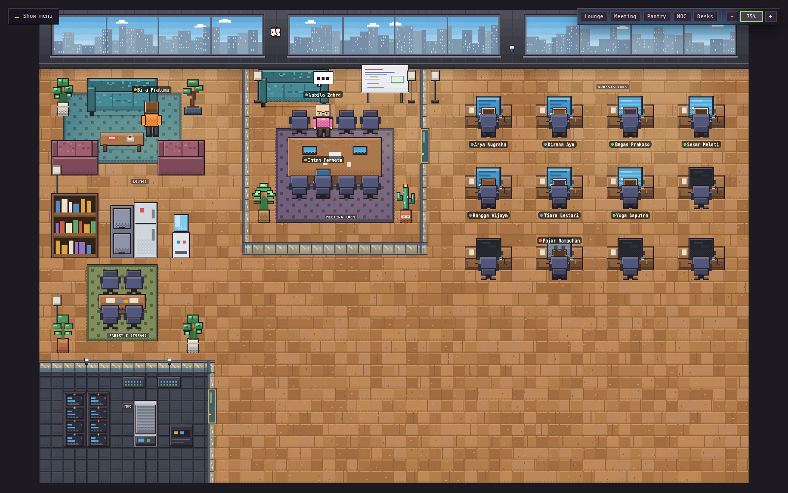
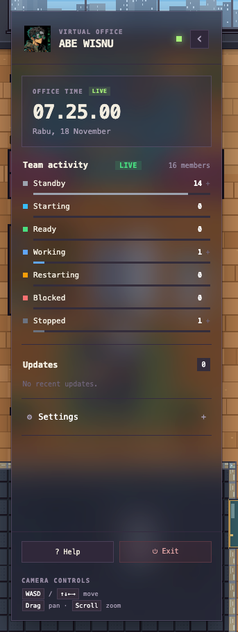
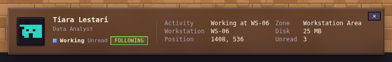
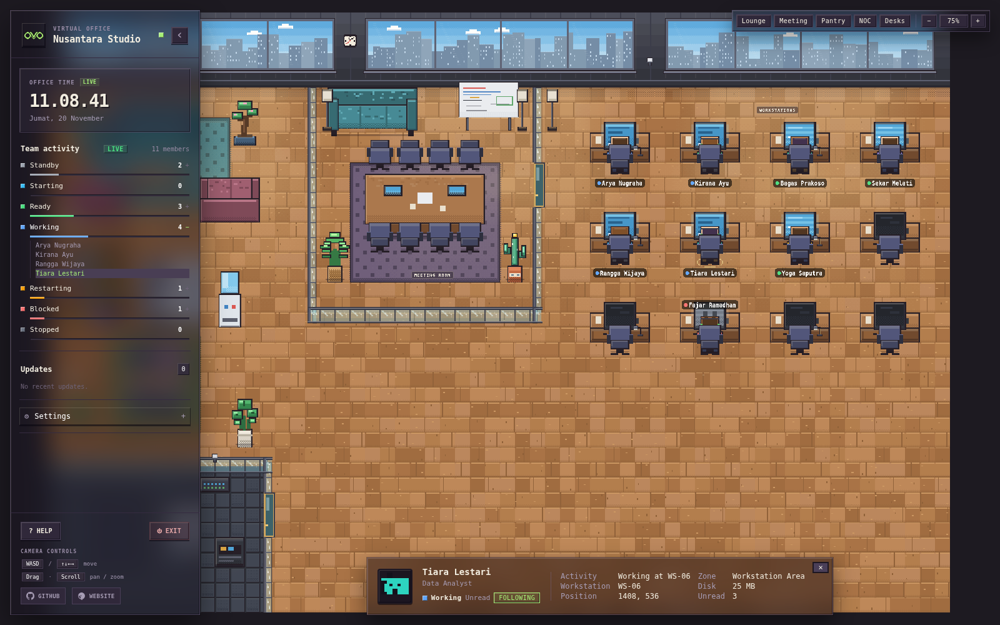
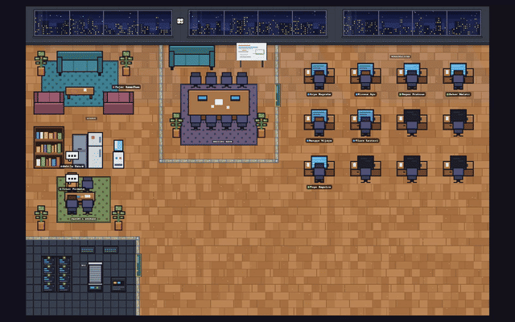

# OpenBot Virtual Office (OVO)

<p align="center">
  
</p>

<!-- Badges built with https://github.com/ileriayo/markdown-badges (shields.io) -->
[](LICENSE)
[](package.json)
[](package.json)
[](package.json)
[](package.json)
[](package.json)
[](package.json)
[](package.json)
[](docs/OPENBOT_OFFICE_API.md)
[](#license)

💙 **Support OVO:** If you find this project useful, you can support its maintenance and future development with a voluntary donation.

### Crypto donations

| Network | Address |
|---|---|
|[](#crypto-donations) | `bc1qp9qsdgnwfpce307crhguhjvvq8hdlcjwn4260c` |
|[](#crypto-donations) | `0xec37d1638Bcb0241eB2e9e5bE98983e91aa3bE45` |
|[](#crypto-donations) | `DLmb29BaPDGZk3iSv3enaLiHRFjQ1mvwdjk4mNkfLjXM` |
|[](#crypto-donations) | `0xec37d1638Bcb0241eB2e9e5bE98983e91aa3bE45` |

> USDT transfers can go via ERC-20, SPL, or Polygon. BTC is native. Verify the address before sending.

**PayPal:** [paypal.me/abewisnu](https://paypal.me/abewisnu)

**OpenBot Virtual Office** — **OVO** for short — is a *visualisation* of the work running inside
OpenBot, rendered as a 2D pixel-art virtual office. Its role is **observe only**: OVO has no chat, no
command box, and cannot send instructions to an agent. Instructions stay in OpenBot itself; OVO shows
the consequences — who is working, who is idle, who is waiting for an answer, and who has unread
messages.

An open-plan office world in an *Elevated Top-Down Orthographic* style that you can pan and zoom.
Every asset is generated programmatically (no external image files).

The office canvas fills the viewport; the sidebar is a **floating panel** laid over it —
fixed with a 16 px gap from the top, left and bottom edges, an all-round 1 px border and a
layered drop shadow, and square corners throughout (matching the pixel look). No layout space is
reserved for it, so hiding the sidebar leaves the canvas exactly as it was.

The panel is **frosted glass**: `rgba(25, 21, 32, 0.55)` over
`backdrop-filter: blur(20px) saturate(135%)`, so the office reads through it while the text keeps
its contrast. Inner cards, notices and the font picker use thinner translucent layers instead of
opaque fills, and the reopen handle gets the same treatment. Browsers without `backdrop-filter`
fall back to `rgba(25, 21, 32, 0.94)` via `@supports not (...)`, so the panel never turns into
translucent text over sprites.

**Team activity** lists one row per phase with its count. Clicking a non-empty row expands the
agents in that phase (alphabetical, real `name` from the roster); clicking a name focuses that agent
in the office and opens its info panel. Empty phases are disabled — nothing to list.

The data is **not mock**: the app reads OpenBot's SQLite database **read-only** through
`GET /api/agents` and renders each agent's `phase` + `activity`. The mock roster is a
**last resort**: the board opens empty with a grey `Connecting` badge, fills from the
first successful fetch, and only falls back to mock when a fetch actually fails on a board
that never loaded live. A polling error on a working board keeps the last live snapshot.

Start here:
- [`docs/OPENBOT_OFFICE_API.md`](docs/OPENBOT_OFFICE_API.md) — data contract (wire shape, fields, windows)
- [`docs/OPENBOT_OFFICE_RUNTIME.md`](docs/OPENBOT_OFFICE_RUNTIME.md) — runtime & operations
- [`docs/OPENBOT_OFFICE_GUIDE.md`](docs/OPENBOT_OFFICE_GUIDE.md) — implementation map (file by file)
- [`docs/OVO_OFFICE_LAYOUT.md`](docs/OVO_OFFICE_LAYOUT.md) — rooms, tile coordinates, dressing
- [`docs/OVO_ART_STYLE.md`](docs/OVO_ART_STYLE.md) — pixel-art spec, depth pass, motion & performance
- [`docs/OVO_THEME.md`](docs/OVO_THEME.md) — sidebar font and UI theme
- [`docs/OVO_AVATARS.md`](docs/OVO_AVATARS.md) — avatar recipe, info-card chrome, workspace footprint
- [`docs/OVO_PHASES.md`](docs/OVO_PHASES.md) — phase / activity rules and per-phase office effects

## Screenshots

Every shot in `docs/assets/` came from the running app in a **1600 × 1000** viewport at 2× device
pixels, dark theme, fed by a **dummy roster of 10 agents** served on the normal `/api/agents` route
(same field set as the real endpoint, so the sidebar badge reads `Live`). Only the first file is a
full frame; the others are crops, so their pixel sizes differ:

| File | Pixels | Frame |
|---|---|---|
| `office-overview.png` | 3200 × 2000 | full viewport (1600 × 1000 at 2×), sidebar hidden |
| `sidebar.png` | 343 × 911 | crop of the floating sidebar |
| `info-panel.png` | 1396 × 238 | crop of the info card |
| `agent-panel.png` | 1414 × 911 | crop around the selected agent and its card |
| `office-activity.gif` | 640 × 400 | 10 s clip, 10 fps, downscaled from the capture |

The workspace identity is
a demo one — name **Nusantara Studio**, custom pixel logo — so the documentation never shows a real
account name or logo. No mock lives in a component: the world, the sidebar and the info card all
read the same store shape they read in production.

<!-- Side-by-side on GitHub, stacked on narrow screens: two cells, one image each. -->
|  |  |
|:--:|:--:|
| **1 · Full office, sidebar hidden** — the canvas owns the whole viewport: workstation block on the right (4 bays per row, one desk per agent), Meeting Area, Lounge, Pantry & Storage and the raised-floor NOC on the left. Hiding the sidebar reserves no layout space, so the office is pixel-for-pixel identical behind it. | **2 · Sidebar** — the frosted panel floats 16 px from every edge, showing the demo workspace **Nusantara Studio** with its own pixel logo, the `Live` source badge and clock, one row per phase with a clickable count, the recent-updates feed, and the Settings / Help / Exit controls. |



**3 · Info panel** — close-up of the card: the agent's name and role, the live `phase` badge with the
single highest-priority `activity` note, then placement (`Zone`, workstation id), workspace footprint
on disk, world `Position` and `Unread` count. The pixel face is drawn from `avatarSeed`, so the same
agent keeps the same face on every reload.



**4 · Agent selected in the office** — the same card in context: clicking an agent in the canvas (or
a name in the `Working` row) outlines it and pins the info strip to the bottom of the stage, while the
sidebar keeps the roster visible. This is the whole page, so it also shows how the floating panels sit
over the office.



**5 · Ten seconds of activity** — `docs/assets/office-activity.gif`: 10 s, 10 fps, 640 × 400,
looped. Agents walk to their desks and type while `Working`, pair up on the Lounge sofas, the Meeting
Area and the Pantry when idle, and the name plate under a working workstation rides below its chair.

> Regenerating these: start `npm run dev`, answer `/api/agents` with any fixture array that matches
> the real field set, answer `/api/office-logo` and `/api/office-profile` with the demo identity, let
> the agents settle for a few seconds, then capture — full page with the sidebar hidden, the sidebar
> alone, the info card close-up, the page with an agent selected, and a 10 s screen recording
> converted to GIF (`ffmpeg -ss 14 -t 10 -i capture.webm -vf "fps=10,scale=640:-1" office-activity.gif`).

## Integration with OpenBot


OVO is a companion viewer for **[OpenBot](https://github.com/nightly-labs/openbot)** — the local-first
desktop workspace for persistent AI teammates, built by
**[nightly-labs](https://github.com/nightly-labs)** ([openbot.run](https://openbot.run/)). OpenBot does
the work: it runs the agents, their workspaces, the task queue and the conversation. OVO never
duplicates that — it only **reads** the SQLite database OpenBot already writes (a handful of tables
per request, `readonly: true`, no writes, no calls back into OpenBot) and turns the result into a room
you can watch.

> **This is not the CopilotKit project.** OVO integrates with `nightly-labs/openbot`. It is unrelated
> to [`CopilotKit/OpenBot`](https://github.com/CopilotKit/openbot) ([open.bot](https://open.bot)), a
> different product from CopilotKit. Both happen to share the name "OpenBot"; only
> `nightly-labs/openbot` is the application this office visualises.

## Prerequisites

- **Node.js 22.18+** (tested on Node 24) and npm. The `npm run verify` scripts
  import `.ts` modules directly and need Node's unflagged type stripping.
- OpenBot installed on the same machine, because OVO reads OpenBot's `openbot.db` in read-only mode.
  Default per-OS locations are listed in
  [`docs/OPENBOT_OFFICE_RUNTIME.md`](docs/OPENBOT_OFFICE_RUNTIME.md); override with
  `OPENBOT_DB_PATH`.
- Without OpenBot/DB the app still runs, but falls back to mock data (source badge in the sidebar).
  The mock roster is shown only after a fetch fails; before the first reply the badge reads
  `Connecting` and the list is empty.

## Running
```bash
npm install
npm run dev      # http://localhost:5173  (the only mode that has /api/agents)
npm run build    # type-check + production build into dist/
npm run preview  # static dist/ — NO API, the UI falls back to mock
npm run verify   # every gate below, in one run; exits 1 on the first failure

node scripts/verify-monitor.mjs        # phase × seated matrix + monitor source guards
node scripts/verify-openbot-source.mjs # check the SQL queries stay read-only
node scripts/verify-lounge.mjs         # `starting`/`restarting` agents stay inside the Lounge room
node scripts/verify-store.mjs          # roster source states: never mock before a failed fetch
node scripts/verify-workspace.mjs      # workspace-folder size walker + no path leak to the browser
node scripts/verify-avatar.mjs         # per-theme tint contrast on both avatar surfaces
node --import ./scripts/register-ts.mjs scripts/verify-chairs.mjs  # chair collision + meeting-room chat
node --import ./scripts/register-ts.mjs scripts/verify-rooms.mjs  # pantry spacing, NOC server-room dressing, carpet
node --import ./scripts/register-ts.mjs scripts/verify-idle.mjs  # standby agents sit and chat in the social rooms
node --import ./scripts/register-ts.mjs scripts/verify-rack-leds.mjs # rack LED blink rate table
node scripts/verify-labels.mjs         # agent name plate + status dot size and seated height
```

`npm run preview` and any other static host do not serve `/api/agents`: the request falls through to
`index.html` with status `200`. Check `Content-Type`, do not trust the status code alone.

GitHub Actions runs the same gates on every push and pull request: `.github/workflows/gates.yml`
installs with `npm ci`, runs `npm run typecheck` (browser **and** Node side), then `npm run verify`
and a throwaway `vite build` into `$RUNNER_TEMP`, so CI never writes `dist/`. A second workflow,
`.github/workflows/pages.yml`, uploads `docs/` to GitHub Pages when anything under `docs/` changes.

## Controls
WASD / arrow keys / drag = camera · scroll or `+`/`-` = zoom (`0.70x`–`3x`, starts at `0.75x`) · hover a
character **or its workstation** = highlight ring + cursor `pointer` · click a
character **or its workstation computer** = info panel · `E` = randomise simulation status · `Esc` = close panel.

The camera (pan + zoom) persists in `localStorage` under `ovo-view` and the selected agent in
`?agent=<id>` on the URL, so a reload reopens the office where it left off with the same agent
selected. Both are inert for a fresh visitor — no stored view, no query — so the shipped defaults
still win.

URL `?props=<n>` scales props by `n` (0.5–4, default `2`); the floor, glass partitions and doors stay on the tile grid so nothing overshoots. A door opening is `DOOR_SPAN` tiles wide (`src/constants.ts`, 3) and its leaf is one sprite centred on the opening.

### Rooms

Five zones share one floor plate: Meeting, Workstations, Lounge, Pantry & Storage, and NOC —
only the Meeting Room is glassed in. `zoneName()` in `src/office/Layout.ts` returns the name the
HUD shows for the tile under the pointer. Tile coordinates, the meeting-room whiteboard and the
NOC rack / CRAC / UPS dressing live in
[`docs/OVO_OFFICE_LAYOUT.md`](docs/OVO_OFFICE_LAYOUT.md).

## Architecture

| File | Role |
|---|---|
| `src/office/AssetGenerator.ts` | All pixel art drawn on Canvas 2D → `Texture` (nearest filter): floor, walls, windows, glass, furniture, characters, monitors. |
| `src/office/Layout.ts` | `buildLayout(deskCount)`: rooms, collision grid, seats `WS-NN`, chat spots. |
| `src/office/Pathfinder.ts` | BFS over the tile grid. |
| `src/office/Character.ts` | Sprite, idle/walk/sit + typing, speech bubble, name label, status dot. |
| `src/office/Monitor.ts` | Pure `monitorStateFor(phase, seated)` → `off`/`still`/`moving`/`waiting`. |
| `src/office/DayCycle.ts` | Pure daylight curve, seven keyframes → tint + ray strength. |
| `src/office/Particles.ts` | Dust motes in window shafts; steam / air emitters over dispensers, coffee tables and CRACs. |
| `src/office/Atmosphere.ts` | God rays, floor light pools, pixel-stepped vignette. |
| `src/office/Lounge.ts` | Pure Lounge box + `staysInLounge(phase)` (`starting`, `restarting`). |
| `src/office/Idle.ts` | Pure standby rules: `isSocialZone()`, `pickIdleSeat()`, `visAVis()`. |
| `src/office/Avatar.ts` | Pure avatar recipe: `stableIndex()` + `avatarSpec()` with per-theme contrast clamps. |
| `src/office/World.ts` | Pixi scene, Y-sorting, camera, input, agent placement, monitor state. |
| `src/store/useStore.ts` | Zustand: employees, selection, notifications, 3 s polling. |
| `src/store/sourcePolicy.ts` | Pure roster-source policy: `pending` → `openbot` → `mock`. |
| `src/data/openbotSource.node.ts` | Node side: SQLite `readonly`, 11 queries, derives `phase` + `activity`. |
| `src/data/workspaceSize.node.ts` | Measures an agent's workspace folder (server-side only). |
| `src/data/openbotSource.ts` | Type contract, Zod schema, fetch client. |
| `vite-plugin-openbot.ts` | Dev-only middleware: `/api/agents`, `/api/office-logo`, `/api/office-profile`. |
| `src/components/*` | HUD, info panel, canvas host. |

Per-file detail (geometry, pixel-art recipe, pure-module contracts) lives in the `docs/OVO_*.md` docs; file-by-file ownership is in [`docs/OPENBOT_OFFICE_GUIDE.md`](docs/OPENBOT_OFFICE_GUIDE.md) §2.

## Phases and activity

Two independent signals describe an agent: **`phase`** (what the runtime is doing — decides where
the character sits and what its desk screen shows) and **`activity`** (the single highest-priority
event attached to it — the note printed beside the phase label, and the reason `waiting` /
`unread` pull the agent to its own desk). Both are re-derived from `openbot.db` on every request.

Full rules — activity kinds + weights, the seven phases with triggers and office effects, and the
per-phase × per-activity matrix — live in
[`docs/OVO_PHASES.md`](docs/OVO_PHASES.md).

## Typography

The sidebar font is picked in **Settings → Sidebar font**: `mono` (default, system monospace) or
**Geist Pixel** (self-hosted pixel face, SIL OFL 1.1). The choice resets on reload. The static
`docs/` site uses Geist Pixel for all text and loads nothing from a third party.

Full spec — typeface table, self-hosting details, OFL licence, the `docs/site.css` setup, and the
two deliberate exceptions — lives in [`docs/OVO_THEME.md`](docs/OVO_THEME.md).

## Theme

The UI chrome has three modes, picked in **Settings → Theme**: `system` (default, follows the OS
and keeps following it live), `light`, `dark`. The canvas office art is **not** themed — it is
pixel art drawn once into textures, so it keeps its own day/night look; the light palette is a warm
paper tone chosen so the frosted sidebar still reads as an overlay. The choice resets on reload.

`src/theme.ts` resolves the mode to a palette and writes two attributes on `<html>`
(`data-theme`, `data-theme-mode`); while the mode is `system`, a live `prefers-color-scheme`
listener re-applies on change. Full spec — the CSS custom-property palette, the inline script in
`index.html` that sets `data-theme` before React mounts, and the per-`prefers-color-scheme`
`theme-color` metas — lives in [`docs/OVO_THEME.md`](docs/OVO_THEME.md).

## Art style

The office is **32-bit high-resolution pixel art** — every tone is a literal `#rrggbb` written
into an RGBA canvas, nothing is indexed. Detail comes from 2× texture density, multi-step shading
ramps, dithered gradients, contact shadows (AO) and an atmospheric runtime layer. Edges stay hard:
the art is drawn once into textures with `nearest` sampling and `roundPixels: true`, then scaled
by whole numbers only.

| Measure | Value |
|---|---|
| Base tile | 16×16 art px (`TILE = 32` screen px at `ART = 2`) |
| Floor plate | 960×640 art px = 60×40 tiles (`COLS × ROWS`) |
| Texture density | `DENSITY = 2` texels per art px |
| Upscale | props at 4 screen px per art px (`PROP_SCALE 2`); floor stays at 2 (`ART`) |

Full spec — the measure table, why 32-bit rather than 16-bit, the depth pass (prop detail, day
cycle, atmosphere, particles, hover/selection), and the motion & performance budget — lives in
[`docs/OVO_ART_STYLE.md`](docs/OVO_ART_STYLE.md).

## Avatars

The info panel draws each agent's face from its **seed**, not from a picture. OpenBot keeps no
avatar image in `openbot.db`: `projection_agents.agent_json` carries `avatarSeed` (always set),
`avatarHue` and `avatarColor` (sometimes `null`), and those three alone decide the face.
`src/office/Avatar.ts` is the whole recipe — FNV-1a + murmur3-style avalanche into a stable index,
then per-theme tint clamps that guarantee 3:1 contrast on both the avatar tile and the panel
gutter, on both palettes.

The info card is square-cornered glass like the sidebar: `border-radius: 0`, `backdrop-filter:
blur(18px) saturate(135%)`, anchored to the bottom centre, collapsing from a horizontal row on
desktop to a stacked card on mobile. `src/components/Avatar.tsx` draws the face as a 12×12 SVG with
`shapeRendering="crispEdges"` — zero network requests, zero new dependencies.

Each agent's **workspace footprint** (the `Disk` row on the card) is measured server-side in
`src/data/workspaceSize.node.ts` from `projection_agents.agent_json.workspacePath`, bounded and
read-only; the path never reaches the browser — `/api/agents` forwards only `workspaceBytes`, an
integer or `null`.

Full recipe — the hash, the per-theme contrast table with the worst-case ratios on the real
16-agent roster, the card chrome, and the workspace-footprint walk — lives in
[`docs/OVO_AVATARS.md`](docs/OVO_AVATARS.md).

## Ground rules
- **Name**: OpenBot Virtual Office, **OVO** for short.
- **Purpose**: a 2D pixel-art visualisation of the work already happening in OpenBot — not a work app.
- **Boundary**: no chat, no instructions, no task submission. Instructions are written in OpenBot.
- **Data source**: OpenBot's `openbot.db`, opened with `readonly: true`, `fileMustExist: true`.
- **No database of its own**: OVO reads OpenBot's `openbot.db` read-only and writes no rows. The
  only things it stores are its own view state — the camera in `localStorage` and the selected
  agent in the URL — so a reload reopens where the visitor left off.
- **Truth**: the code is the source of truth; the docs describe the code that exists, and designs
  that are not built yet are clearly marked *not implemented*.
- **Supported mode**: the Vite dev server (`npm run dev`) — the only mode with `/api/agents`.

## Notes
- **Identity & boundary**: OVO = OpenBot Virtual Office, a 2D pixel-art visualisation of OpenBot work.
  It is not a control surface: no chat, no instruction box, no way to send a task from the office. The
  only I/O to the server is read-only: `GET /api/agents` for the agent snapshot and
  `GET /api/office-logo` for the workspace logo bytes and `GET /api/office-profile` for
  the OpenBot profile name (`grep 'fetch(' src` = 3 hits, no `POST`).
- Perspective: horizontal/vertical grid, no vanishing point; depth comes from Y-sorting only.
- Room layout (lounge, pantry, NOC, sitters, name plates, room plates, rack LEDs, monitor rules)
  — see [`docs/OVO_OFFICE_LAYOUT.md`](docs/OVO_OFFICE_LAYOUT.md).
- Simulated positions, phase rules and activity notes — see
  [`docs/OVO_PHASES.md`](docs/OVO_PHASES.md).
- `phase` is recomputed from the database on every request. An agent with no traffic for > 30 minutes
  drops to `idle` (Standby) — a quiet board is correct, not a bug.
- Canvas window scenery follows the local clock (night 19:30–06:00); this is pixel art, unrelated to
  the UI **Settings → Theme** mode.
- Size/speed/colour constants live in `src/constants.ts`, including `DOOR_SPAN` (door opening in tiles, 3) and `PROP_SCALE` (`?props=` default 2).
- `dist/` is immutable per build; never edit build output, rebuild instead.

## License

MIT — see [`LICENSE`](LICENSE). © 2026 Abe Wisnu.
