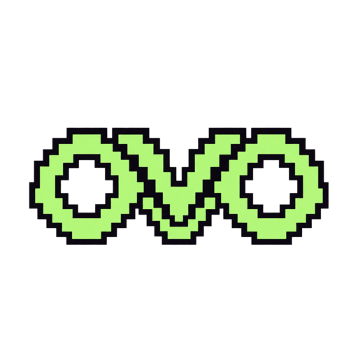

# OpenBot Virtual Office (OVO)



<!-- Badges built with https://github.com/ileriayo/markdown-badges (shields.io) -->
[](LICENSE)
[](package.json)
[](package.json)
[](package.json)
[](package.json)
[](package.json)
[](package.json)
[](package.json)
[](docs/OPENBOT_OFFICE_API.md)
[](#license)

**OpenBot Virtual Office** — **OVO** for short — is a *visualisation* of the work running inside
OpenBot, rendered as a 2D pixel-art virtual office. Its role is **observe only**: OVO has no chat, no
command box, and cannot send instructions to an agent. Instructions stay in OpenBot itself; OVO shows
the consequences — who is working, who is idle, who is waiting for an answer, and who has unread
messages.

An open-plan office world in an *Elevated Top-Down Orthographic* style that you can pan and zoom.
Every asset is generated programmatically (no external image files).

The data is **not mock**: the app reads OpenBot's SQLite database **read-only** through
`GET /api/agents` and renders each agent's `phase` + `activity`. Mock is used only as a fallback when
the database cannot be read, and the sidebar shows a badge for the active source.

Start here: [`docs/OPENBOT_OFFICE_API.md`](docs/OPENBOT_OFFICE_API.md) (data contract),
[`docs/OPENBOT_OFFICE_RUNTIME.md`](docs/OPENBOT_OFFICE_RUNTIME.md) (runtime & operations),
[`docs/OpenBot-OFFICE-API-GUIDE.md`](docs/OpenBot-OFFICE-API-GUIDE.md) (implementation map).

## Integration with OpenBot


OVO is a companion viewer for **[OpenBot](https://github.com/nightly-labs/openbot)** — the local-first
desktop workspace for persistent AI teammates, built by
**[nightly-labs](https://github.com/nightly-labs)** ([openbot.run](https://openbot.run/)). OpenBot does
the work: it runs the agents, their workspaces, the task queue and the conversation. OVO never
duplicates that — it only **reads** the SQLite database OpenBot already writes (a handful of tables
per request, `readonly: true`, no writes, no calls back into OpenBot) and turns the result into a room
you can watch.

> **This is not the CopilotKit project.** OVO integrates with `nightly-labs/openbot`. It is unrelated
> to [`CopilotKit/OpenBot`](https://github.com/CopilotKit/openbot) ([open.bot](https://open.bot)), a
> different product from CopilotKit. Both happen to share the name "OpenBot"; only
> `nightly-labs/openbot` is the application this office visualises.

## Prerequisites

- **Node.js 20+** (tested on Node 24) and npm.
- OpenBot installed on the same machine, because OVO reads OpenBot's `openbot.db` in read-only mode.
  Default per-OS locations are listed in
  [`docs/OPENBOT_OFFICE_RUNTIME.md`](docs/OPENBOT_OFFICE_RUNTIME.md); override with
  `OPENBOT_DB_PATH`.
- Without OpenBot/DB the app still runs, but falls back to mock data (source badge in the sidebar).

## Running
```bash
npm install
npm run dev      # http://localhost:5173  (the only mode that has /api/agents)
npm run build    # type-check + production build into dist/
npm run preview  # static dist/ — NO API, the UI falls back to mock

node scripts/verify-monitor.mjs        # phase × seated matrix + monitor source guards
node scripts/verify-openbot-source.mjs # check the SQL queries stay read-only
```

`npm run preview` and any other static host do not serve `/api/agents`: the request falls through to
`index.html` with status `200`. Check `Content-Type`, do not trust the status code alone.

## Controls
WASD / arrow keys / drag = camera · scroll or `+`/`-` = zoom (`0.70x`–`3x`, starts at `0.75x`) · click a
character = info panel · `E` = randomise simulation status · `Esc` = close panel.

## Architecture
| File | Role |
|---|---|
| `src/office/AssetGenerator.ts` | All pixel art (floor, walls, windows + day/night skyline, glass partitions, furniture, lit/unlit monitors, 4-direction characters + walk/sit frames, speech bubble) is drawn on a Canvas 2D → `Texture` (filter `nearest`). One pixel-art pixel = 2 screen px. |
| `src/office/Layout.ts` | Room layout (Lounge, Meeting, Workstation, Pantry/Storage), collision grid, seat and chat-spot lists. Desk count `buildLayout(deskCount)` follows the agent roster, clamped to 12–16, seats `WS-01…WS-N`. |
| `src/office/Pathfinder.ts` | BFS over the tile grid so characters walk around furniture. |
| `src/office/Character.ts` | Sprite, idle/walk/sit animations plus typing variants and speech bubble, name label, status indicator. |
| `src/office/Monitor.ts` | Pure `monitorStateFor(phase, seated)` → `off`/`still`/`moving`: the "seated first, then lit" gate, used by `World.ts` and covered by `scripts/verify-monitor.mjs`. |
| `src/office/World.ts` | Pixi scene, Y-sorting (`zIndex` = bottom edge of an object), camera + bounds, input, agent placement: `working`/`ready` sit at a desk, agents with unread/waiting walk to their own desk. `updateMonitors()` lights a desk screen only when the agent is genuinely seated on that chair (`seat.occupant` **and** `Character.state === 'sit'` on the same `seat`) with `phase` `working`/`ready`; `working` uses animated frames, `ready` a still frame. A chair is already reserved the moment an agent starts walking, so `seat.occupant` alone is not enough — the screen stays dark while the agent is still walking. |
| `src/store/useStore.ts` | Zustand: employees derived from the API, selection, notifications, UI settings, 3 s polling loop. |
| `src/data/openbotSource.node.ts` | Node side: opens SQLite `readonly`, 11 queries, derives `phase` + `activity`. |
| `src/data/openbotSource.ts` | Type contract + Zod `agentProfileSchema` + fetch client. |
| `vite-plugin-openbot.ts` | Dev-only middleware: `GET /api/agents` (Host/method guards, security headers, strips `provider`/`model`/`threadId`), `GET /api/office-logo` streaming the workspace logo from OpenBot's app-support folder (`204` when none), and `GET /api/office-profile` returning the workspace name as JSON. |
| `src/components/*` | HUD, character info panel, canvas host (React overlay on top of Pixi). |

## Ground rules
- **Name**: OpenBot Virtual Office, **OVO** for short.
- **Purpose**: a 2D pixel-art visualisation of the work already happening in OpenBot — not a work app.
- **Boundary**: no chat, no instructions, no task submission. Instructions are written in OpenBot.
- **Data source**: OpenBot's `openbot.db`, opened with `readonly: true`, `fileMustExist: true`.
- **No storage of its own**: no database, no persistence, state lives in browser memory only.
- **Truth**: the code is the source of truth; the docs describe the code that exists, and designs
  that are not built yet are clearly marked *not implemented*.
- **Supported mode**: the Vite dev server (`npm run dev`) — the only mode with `/api/agents`.

## Notes
- **Identity & boundary**: OVO = OpenBot Virtual Office, a 2D pixel-art visualisation of OpenBot work.
  It is not a control surface: no chat, no instruction box, no way to send a task from the office. The
  only I/O to the server is read-only: `GET /api/agents` for the agent snapshot and
  `GET /api/office-logo` for the workspace logo bytes and `GET /api/office-profile` for
  the workspace name (`grep 'fetch(' src` = 3 hits, no `POST`).
- Perspective: horizontal/vertical grid, no vanishing point; depth comes from Y-sorting only.
- Simulated positions move on their own every ±20–45 s (working → desk, meeting → meeting area,
  break → lounge, chat → chat spot, idle → wandering). This is simulation `Status`, separate from the
  real agent `phase`, so the office stays alive when the database cannot be read.
- A desk monitor lights up only if the agent is **already seated** on that chair (state `sit` on the
  same `seat`) and its `phase` is `working` or `ready`. The chair is reserved from the moment the agent
  starts walking, so an agent still walking to its desk = screen stays dark.
  `working` = screen **moving** (4 frames, code rows scroll one pixel per frame, caret moves, swap
  every 220 ms); `ready` = screen **still**. `idle`/`blocked`/`restarting`/`stopped` = dark screen
  (`World.ts` → `updateMonitors`, `AssetGenerator.ts` → `makeMonitor(on, frame?)`).
- `phase` is recomputed from the database on every request. An agent with no traffic for > 30 minutes
  drops to `idle` (Standby) — a quiet board is correct, not a bug.
- Window theme follows the local clock (night 18:00–06:00).
- Size/speed/colour constants live in `src/constants.ts`.
- `dist/` is immutable per build; never edit build output, rebuild instead.

## License

MIT — see [`LICENSE`](LICENSE). © 2026 Abe Wisnu.
